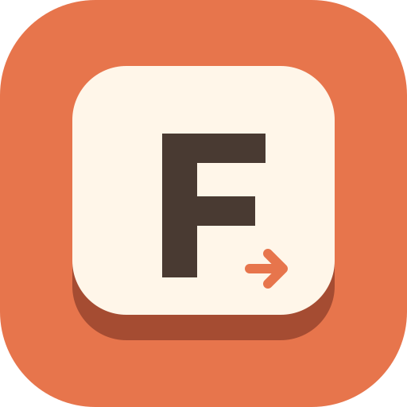
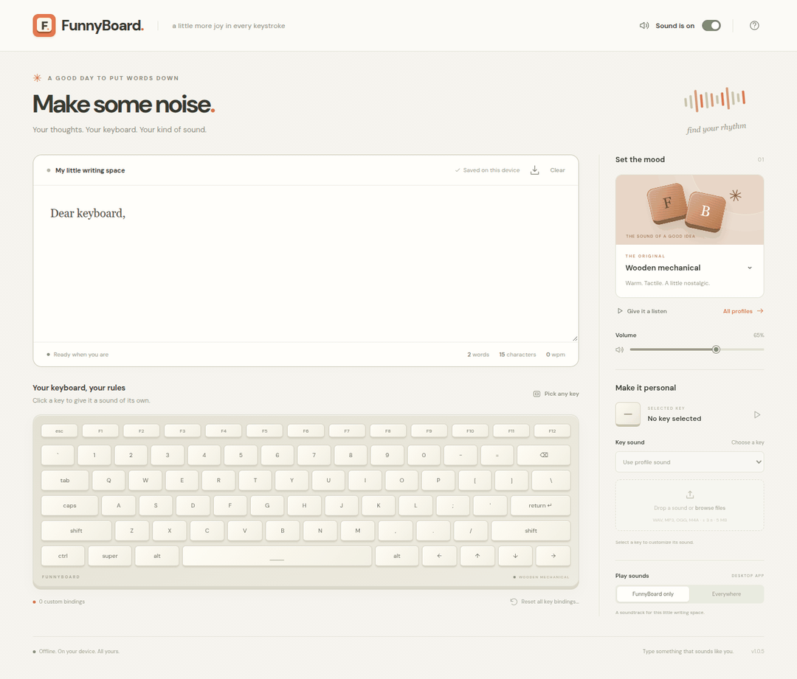

<p align="center">
  
</p>

<h1 align="center">FunnyBoard</h1>

<p align="center">
  <strong>Make every keystroke sound like you.</strong><br>
  Wooden thocks, bubbly pops, or your own audio. Give your keyboard a little personality.
</p>

<p align="center">
  <a href="https://github.com/Nikita-Dudorov/FunnyBoard/releases/latest">Download the latest release</a>
  · <a href="#use-it">How it works</a>
  · <a href="#development">Build it yourself</a>
</p>

<p align="center">
  
</p>

<p align="center">
  <em>Type. Switch moods. Make a key your own.</em><br>
  <sub>Silent animated preview · <a href="docs/assets/funnyboard-preview.png">View a still screenshot</a></sub>
</p>

A desktop writing space with customizable keyboard sounds. Choose from six built-in profiles, assign sounds to individual keys, or create a continuous profile from your own audio.

## Download and install

Download an installer from the [latest release](https://github.com/Nikita-Dudorov/FunnyBoard/releases/latest), when available for your platform:

- **Ubuntu / Debian (x86-64):** open the `.deb` with your software installer.
- **Portable Linux:** make the `.AppImage` executable and run it. Requires FUSE.
- **Windows / macOS:** open the `.exe` installer or `.dmg`.

Installed builds need no Node.js or Python. To build from source, see [Development](#development).

## Use it

- Start typing; **Wooden mechanical** is selected by default. Change profiles under **Set the mood**.
- Click a key on the visual keyboard or use **Pick any key** to assign a built-in sound or upload a clip (up to **3 seconds / 5 MB**). Bindings follow physical keys regardless of typing language.
- Open **All profiles → Create profile from audio** to add a continuous profile (up to **5 minutes / 64 MB**). Longer audio can be cropped without changing the original file. Playback fades when you pause and resumes as you type.
- Adjust volume with the slider; **Ctrl/Cmd + Shift + M** toggles sound while the app is focused. Preview buttons work even when typing sounds are muted.
- Copy, export, or import profiles to reuse setups. Exports include uploaded audio; each profile has independent key bindings. **Reset all key bindings…** clears bindings for the current profile or all profiles.

Notes, profiles, and settings save automatically on your device. The download button above the note saves it as plain text.

## Everywhere mode

Select **Everywhere** to play sounds in other apps. Closing the window keeps FunnyBoard in the system tray, where you can reopen, mute, or quit it. In **FunnyBoard only** mode, closing the window quits.

- **Windows:** works with the bundled keyboard listener.
- **macOS:** grant **System Settings → Privacy & Security → Accessibility** access, then select Everywhere again.
- **Linux:** requires **X11** and `libxtst6`, `libx11-6`, and `libxkbcommon0` (installed by the `.deb`). Wayland supports FunnyBoard-only mode.

The listener handles physical key identifiers and press/release states, never text from other apps. It stops when you disable Everywhere or quit. FunnyBoard has no accounts, telemetry, or network services; your data stays local.

## Development

Requires [Node.js](https://nodejs.org/en/download) **22.12+** (24 recommended) and npm. Installing dependencies requires internet access.

```bash
git clone https://github.com/Nikita-Dudorov/FunnyBoard.git
cd FunnyBoard
npm ci
npm start
```

`npm run preview` serves a browser preview at `http://localhost:4173`; Everywhere requires the desktop app.

```bash
npm run check         # Syntax checks
npm test              # Unit tests
npm run test:ui       # Chrome integration tests
npm run test:desktop  # Linux/X11 integration test
```

UI tests default to `/usr/bin/google-chrome`; override with `CHROME_PATH`. Desktop tests require Python 3 and X11; set `FUNNYBOARD_EXECUTABLE` to test a packaged app.

Build installers on the target operating system. Output goes to `release/`:

| Platform | Command | Output |
| --- | --- | --- |
| Ubuntu / Debian, x86-64 | `npm run dist:linux` | `.deb`, `.AppImage` |
| Windows | `npm run dist:win` | `.exe` |
| macOS | `npm run dist:mac` | `.dmg` |

Debian packaging also requires `dpkg-deb` from the `dpkg` package. Builds are unsigned unless signing credentials are supplied.

Licensed under [MIT](LICENSE). Bundled DM Sans uses the [SIL Open Font License](src/assets/fonts/OFL.txt).
